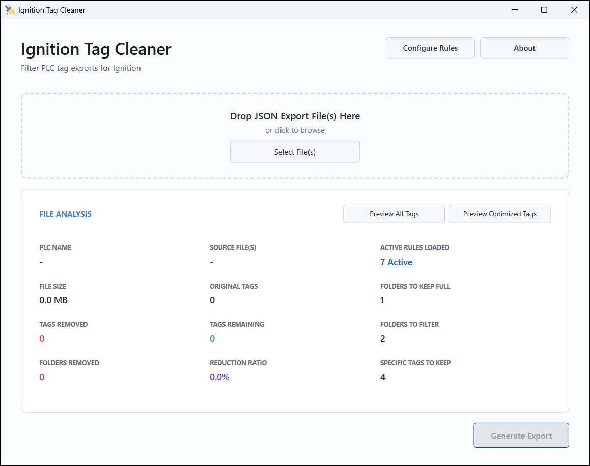
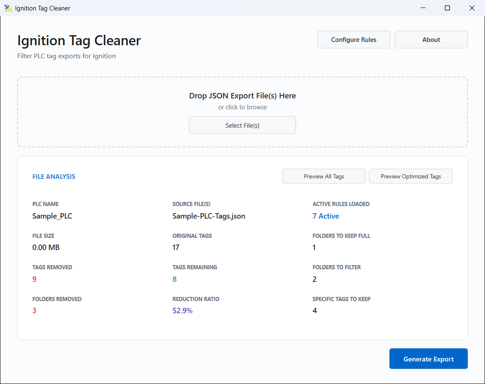
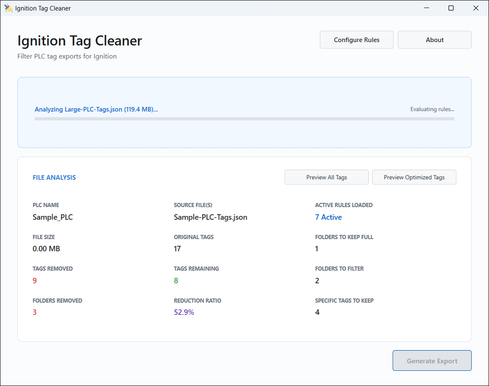
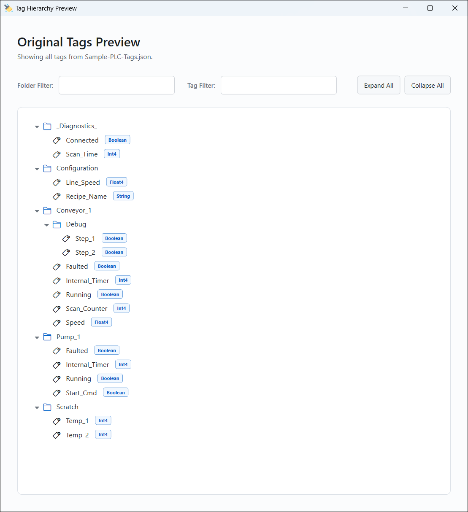
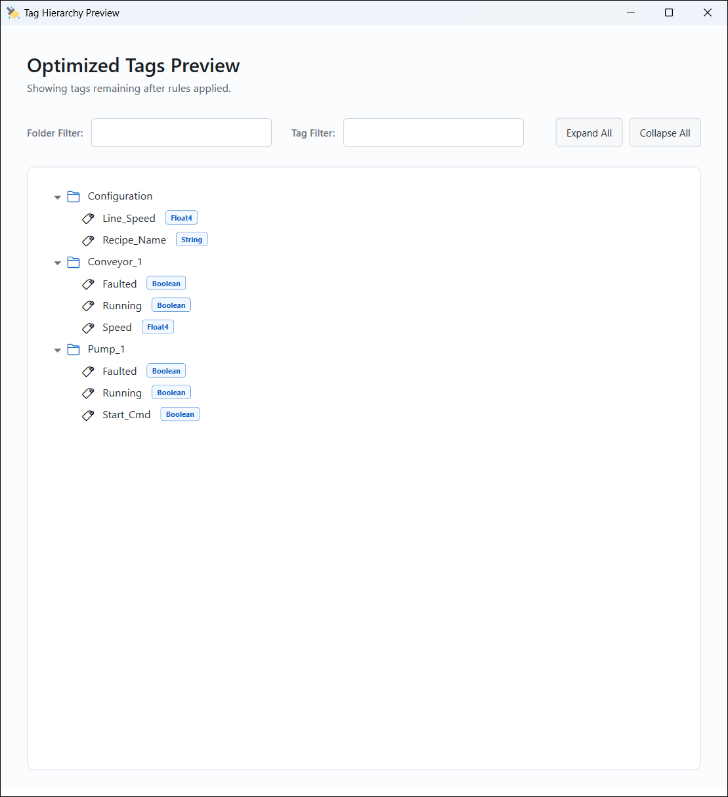
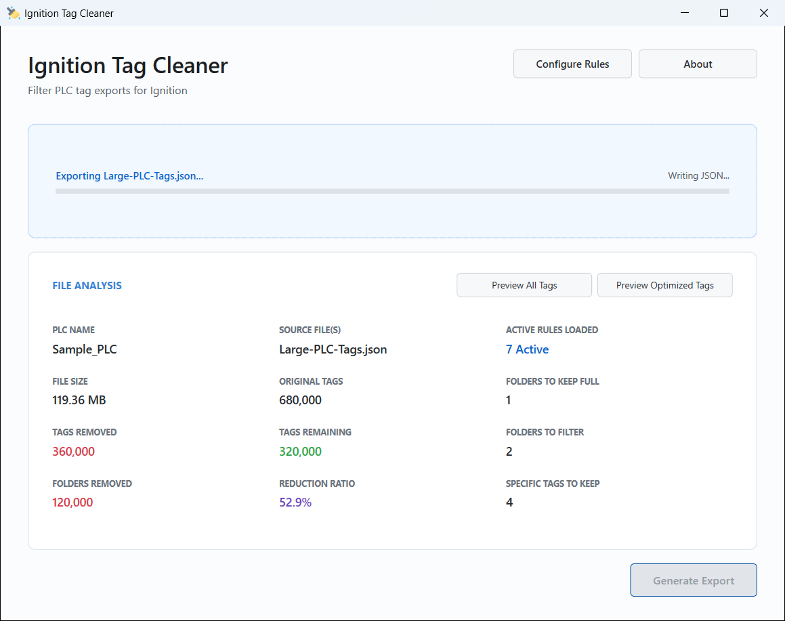
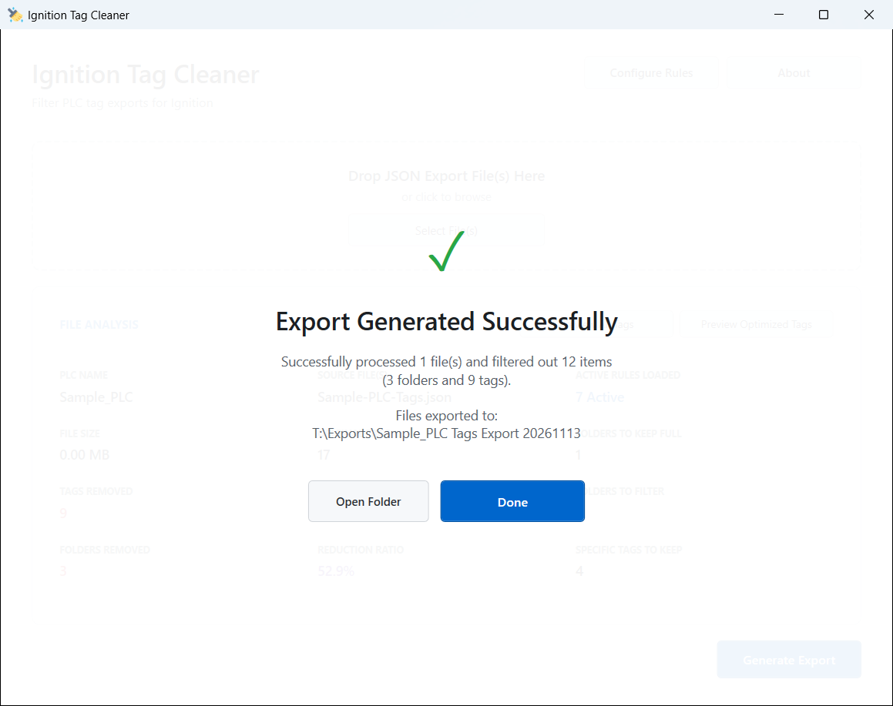
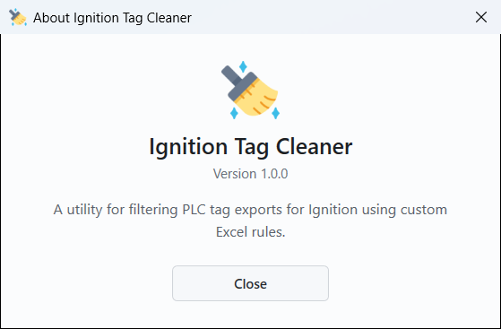

# Ignition Tag Cleaner

<p align="center">
  
  
  
  
  
  
  
</p>

**Ignition Tag Cleaner** is a fast, offline Windows desktop utility that prunes Ignition tag export files down to the folders and tags you actually need, using keep-rules you maintain in an Excel workbook.

A PLC exposes far more tags than a project ever uses: internal, diagnostic and scratch tags sit alongside the ones your screens, alarms and history actually need. Every tag you bring into Ignition has to be polled, so the extra ones cost you on every scan. Even with the PLC's communication load set to its maximum, the OPC UA server and the Ignition gateway still slow down as the tag count grows. Fewer tags means faster polling.

Ignition Tag Cleaner removes the tags you don't need in one pass. Point it at a tag export `.json`, list what you want to keep in `config.xlsx`, preview the result, and it writes a smaller export containing only that, ready to import back into Ignition.

> This is an independent, unofficial tool. It is not affiliated with or endorsed by Inductive Automation.
> Ignition is a trademark of Inductive Automation.

&nbsp;
<p align="center">◈ ◈ ◈</p>
&nbsp;

## Why It Exists

The app came out of a project with more than **200,000 tags across three PLCs**, of which only around **30,000** were needed. That is too many to bring in by hand one at a time, and too many to delete by hand after importing everything. We needed a faster way to filter.

The approach that worked:

1. **Import everything** from the PLCs into Ignition.
2. **Export the full tag set** from the Designer as JSON.
3. **Thin it out** with Ignition Tag Cleaner, using keep-rules in an Excel workbook.
4. **Import the optimized JSON** back into Ignition.
5. **Delete the original, oversized tag set** in Ignition.

Because the rules live in a workbook and not in the export, the process is repeatable. When tags are added or renamed in the PLC, export again, adjust a rule or two, and re-run. The same rules can be applied as many times as the PLC program changes.

&nbsp;
<p align="center">◈ ◈ ◈</p>
&nbsp;

## Application Walkthrough & Features

### 1. Main Dashboard
Load one or more tag exports and see which rules are active before anything is processed.

&nbsp;
<p align="center">
  
</p>
&nbsp;

* **Drag and Drop**: Drop a single export, several exports, or a whole folder, which is searched recursively for `.json` files.
* **File Browser**: Click **Select File(s)** to pick one or more exports instead.
* **Rules at a Glance**: The panel shows how many rules are loaded, split into folders to keep, folders to filter and specific tags to keep.
* **Configure Rules**: Opens `config.xlsx` in Excel. The app reloads the workbook when its window regains focus.

&nbsp;
<p align="center">◈ ◈ ◈</p>
&nbsp;

### 2. File Analysis
See exactly what would be removed before a single file is written.

&nbsp;
<p align="center">
  
</p>
&nbsp;

* **Live Statistics**: Original tags, tags removed, tags remaining, folders removed and the overall reduction ratio.
* **PLC Detection**: The PLC name is read from the export and used to name the output files.
* **Dry Run**: Analysis only reads the export. Nothing is changed until you click **Generate Export**.
* **Rule Changes Re-Analyze**: Edit and save the workbook, switch back to the app, and the numbers update.

&nbsp;
<p align="center">◈ ◈ ◈</p>
&nbsp;

### 3. Processing Large Exports
Large exports are scanned in the background while the window stays responsive.

&nbsp;
<p align="center">
  
</p>
&nbsp;

* **Progress Panel**: Shows the file being processed, its size and the current step.
* **Batch Progress**: With several files, the bar tracks how many have been completed.
* **Built for Size**: The capture above shows a 119 MB synthetic export with 680,000 tags.

&nbsp;
<p align="center">◈ ◈ ◈</p>
&nbsp;

### 4. Original Tags Preview
Browse the complete tag tree of the export exactly as it was loaded.

&nbsp;
<p align="center">
  
</p>
&nbsp;

* **Virtualized Tree**: Folders and tags are shown in a tree that stays quick on very large exports.
* **Folder and Tag Filters**: Narrow the tree by folder name, tag name, or both.
* **Expand All / Collapse All**: Open or close the whole hierarchy in one click.
* **Data Type Labels**: Each tag shows its data type next to its name.

&nbsp;
<p align="center">◈ ◈ ◈</p>
&nbsp;

### 5. Optimized Tags Preview
Check what will remain after your rules are applied, before exporting.

&nbsp;
<p align="center">
  
</p>
&nbsp;

* **Same Tree, After Rules**: The identical view, showing only the folders and tags that survive.
* **Side-by-Side Checking**: Compare against the original preview to confirm nothing you need was dropped.
* **Multi-File Preview**: With several files loaded, each export appears under its own root folder.

&nbsp;
<p align="center">◈ ◈ ◈</p>
&nbsp;

### 6. Generate Export
Write the optimized exports and a summary report to a folder of your choice.

&nbsp;
<p align="center">
  
</p>
&nbsp;
<p align="center">
  
</p>
&nbsp;

* **Dated Output Folder**: Each run creates a new `<PLC> Tags Export <date>` folder, so earlier exports are never overwritten.
* **One File per Input**: Every export is written as `<PLC>_Tags_Optimized_<date>.json`.
* **Summary Report**: A text report lists the folders and tags removed per file, with batch totals.
* **Attributes Preserved**: The attributes of every tag that is kept are written back unchanged.
* **Open Folder**: Jump straight to the results from the success screen.

&nbsp;
<p align="center">◈ ◈ ◈</p>
&nbsp;

### 7. About Screen
Application name and version.

&nbsp;
<p align="center">
  
</p>
&nbsp;

&nbsp;
<p align="center">◈ ◈ ◈</p>
&nbsp;

## Rules Matrix (`config.xlsx`)

The workbook has three sheets. On each one, put the folder or tag name in column **B**; column **A** is a free-text grouping for your own use and is ignored.

<div align="center">

| Sheet | What You List | Effect |
| :--- | :--- | :--- |
| **Folders To Keep** | Folder names | The folder and everything inside it is kept. |
| **Folders To Filter** | Folder names | The folder is kept, but only tags listed on **Tags To Keep** survive inside it, including in its subfolders. The folder is removed if nothing is left. |
| **Tags To Keep** | Tag names | Tags allowed inside filtered folders. |

</div>

How matching works:

* **Exact Names**: Names are matched exactly, ignoring case, at any depth in the tree. There are no wildcards.
* **Unlisted Folders**: Folders not on either folder sheet are kept only if something inside them is kept.
* **Unlisted Tags**: Tags outside a kept or filtered folder are always removed.
* **Disabling a Rule**: Add `FALSE` or `0` in column C to switch a row off without deleting it.

&nbsp;
<p align="center">◈ ◈ ◈</p>
&nbsp;

## Privacy & Safety

* **100% Offline Processing**: No servers, no telemetry and no network calls. Every export is read and written on your machine.
* **Source Files Are Never Modified**: Exports are only read. Results always go to a new dated folder.
* **Excel Not Required to Run**: The workbook is read directly, and can stay open in Excel while the app runs. Excel is only needed to edit the rules.

&nbsp;
<p align="center">◈ ◈ ◈</p>
&nbsp;

## Download & Run Instructions

Ignition Tag Cleaner is distributed as a **portable `.zip`** containing the app, its libraries and the `config.xlsx` rule workbook:

1. Navigate to the [Releases](https://github.com/arshdeepsingh404/Ignition-Tags-Cleaner/releases) tab on the right side of this GitHub repository.
2. Download the latest **`.zip`** file.
3. Extract it to a folder of your choice. Keep the files together; the app reads its rules from the `config.xlsx` next to it.
4. Double-click **`Ignition Tags Cleaner.exe`** to launch.

**No installation required**: it runs from the extracted folder on Windows 10/11. The app needs the [.NET 10 Desktop Runtime](https://dotnet.microsoft.com/download/dotnet/10.0); if it is missing, Windows prompts you to download it the first time you launch.

Then use it:

1. Export tags from the Ignition Designer as JSON.
2. Click **Configure Rules**, list the folders and tags to keep, and save the workbook.
3. Drop the export file(s) or a folder onto the app, or click **Select File(s)**.
4. Check the statistics and use **Preview All Tags** / **Preview Optimized Tags** to inspect the result.
5. Click **Generate Export** and choose a destination.
6. Import the optimized JSON into Ignition, then delete the original tag set.

To try it out, use `Sample/Sample-PLC-Tags.json` with the shipped `config.xlsx`: 9 of 17 tags and 3 of 6 folders are removed.

### Building from Source

Developers can build the app with the [.NET 10 SDK](https://dotnet.microsoft.com/download):

```powershell
dotnet build "Ignition Tags Cleaner.slnx"
dotnet run --project "Ignition Tags Cleaner/Ignition Tags Cleaner.csproj"
```

&nbsp;
<p align="center">◈ ◈ ◈</p>
&nbsp;

## Reporting Bugs & Feedback

If you encounter issues or have feature suggestions, please report them on the [GitHub Issues](https://github.com/arshdeepsingh404/Ignition-Tags-Cleaner/issues) page. Pull requests are welcome.

Please do not include real plant tag exports or site names in issues, samples or tests; use synthetic data like the file in `Sample/`.

&nbsp;
<p align="center">◈ ◈ ◈</p>
&nbsp;

## Development Note

Parts of this app were developed and tested with the help of AI coding tools, [Google Antigravity](https://antigravity.google/) and [Claude Code](https://claude.com/claude-code).

&nbsp;
<p align="center">◈ ◈ ◈</p>
&nbsp;

## License

Released under the [MIT License](LICENSE).
